# Chapter 5 - Insert, Update, and Delete

## Table of Contents

  - [Tech Stack](#tech-stack)
  - [Installation](#installation)
  - [Exercise 1 - Full Table Backup](#exercise-1---full-table-backup)
  - [Exercise 2 - Partial Table Backup](#exercise-2---partial-table-backup)
  - [Exercise 3 - Drop Tables](#exercise-3---drop-tables)
  - [Exercise 4 - Insert Statement Without a Column List](#exercise-4---insert-statement-without-a-column-list)
  - [Exercise 5 - Insert Statement Using a Column List](#exercise-5---insert-statement-using-a-column-list)
  - [Exercise 6 - Update Multiple Columns for a Single Record](#exercise-6---update-multiple-columns-for-a-single-record)
  - [Exercise 7 - Update Multiple Records (Rows)](#exercise-7---update-multiple-records-rows)
  - [Exercise 8 - Write Delete Statements](#exercise-8---write-delete-statements)
  - [Help](#help)
  - [Author](#author)

## Tech Stack

**Sakila Database**

[Back to the top](#table-of-contents)

## Installation

1. Clone the repository to your local machine. (Or just steal my code.)
2. Install MySQL if it is not already installed.
3. Download and install the Sakila sample database.
4. Open the project in VS Code or your preferred SQL editor.
5. Select the Sakila database before running the queries.
6. Run each query individually to verify the results.

[Back to the top](#table-of-contents)

## Exercise 1 - Full Table Backup

### What This Exercise Was About

This exercise focused on creating a complete backup of the `customer` table in the Sakila database. The process involved determining the
number of records in the original table, creating a backup table named `customer_full_backup`, and verifying that the backup contained the
same data as the original table.

### New Concepts

- Using `COUNT(*)` to determine the number of records in a table.
- Creating a backup table from an existing table.
- Comparing record counts between two tables.
- Using `CHECKSUM TABLE` to help verify that the original and backup tables contain matching data.

### Learning Outcomes

- Learned how to create a complete backup of an existing table.
- Practiced verifying a backup by comparing the number of records.
- Learned how checksums can help validate the consistency of copied table data.
- Improved understanding of data backup and verification techniques in MySQL.

### Exercise 1.1 - Count Customer Records

**What This Exercise Was About**

The first part involved writing a query to determine how many records existed in the original `customer` table. This established a baseline
that could be compared with the backup table in the following steps.

**Screenshot of Output:**

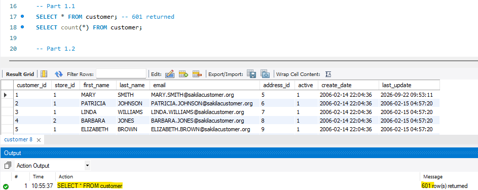

### Exercise 1.2 - Create a Full Table Backup

**What This Exercise Was About**

This part involved creating a complete backup of the `customer` table. The new table was named `customer_full_backup` and contained the
records copied from the original table.

**Screenshot of Output:**

### Exercise 1.3 - Verify the Backup Record Count

**What This Exercise Was About**

After creating the backup, a query was written to count the records in `customer_full_backup`. The result was compared with the record
count from the original `customer` table to confirm that the backup contained the expected number of rows.

**Screenshot of Output:**

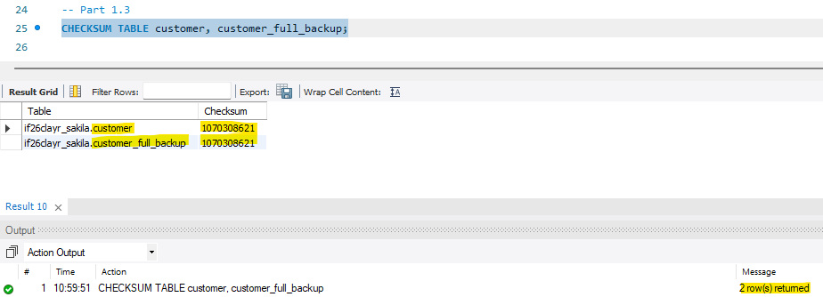

### Exercise 1.4 - Compare Table Checksums

**What This Exercise Was About**

The final part involved using MySQL's `CHECKSUM TABLE` statement to compare the original `customer` table with `customer_full_backup`. This
provided an additional method of checking whether the tables contained matching data.

**Screenshot of Output:**

[Back to the top](#table-of-contents)

---

## Exercise 2 - Partial Table Backup

### What This Exercise Was About

This exercise focused on creating a partial backup of the `rental` table. Instead of copying every rental record, the goal was to identify
rentals that had been returned and create a new table containing only those records.

The backup table was named `returned_rental`.

### New Concepts

- Using `COUNT(*)` to count records in a table.
- Filtering records with `WHERE`.
- Using `IS NOT NULL` to identify rentals with a recorded return date.
- Using `IS NULL` to identify rentals without a recorded return date.
- Creating a partial table backup by selecting records that meet a specific condition.

### Learning Outcomes

- Learned how to identify records based on whether a value is missing.
- Practiced counting records that meet specific conditions.
- Learned how to create a backup containing only selected records.
- Improved understanding of filtering data and verifying query results.

### Exercise 2.1a - Count All Rental Records

**What This Exercise Was About**

This part involved counting the total number of records in the `rental` table. The result established the total number of rentals before
separating returned rentals from rentals that had not been returned.

**Screenshot of Output:**

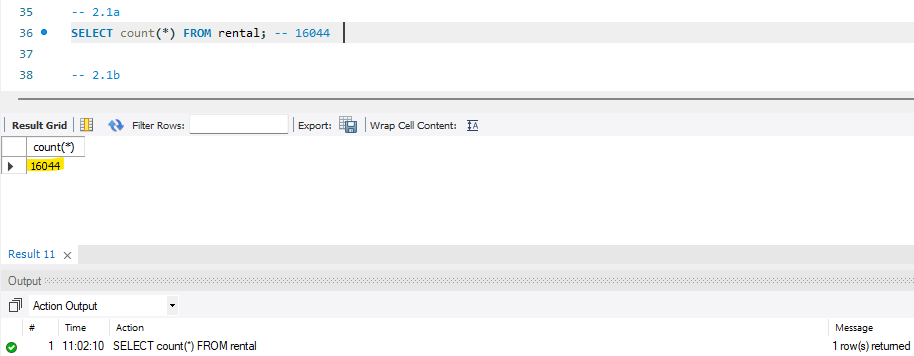

### Exercise 2.1b - Count Returned Rentals

**What This Exercise Was About**

This part involved counting the rental records that had been returned. The `return_date` column was used to identify these records. Rentals
with a recorded return date were counted as returned rentals.

**Screenshot of Output:**

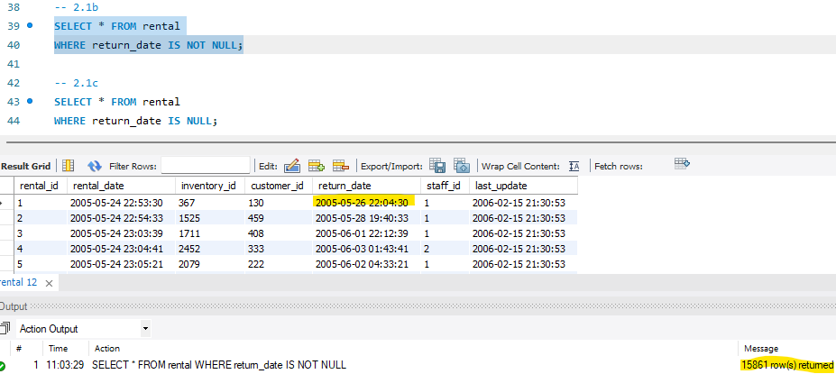

### Exercise 2.1c - Count Rentals Not Returned

**What This Exercise Was About**

This part involved counting rentals that had not been returned. Records with a `NULL` value in the `return_date` column were used to
identify rentals without a recorded return date.

**Screenshot of Output:**

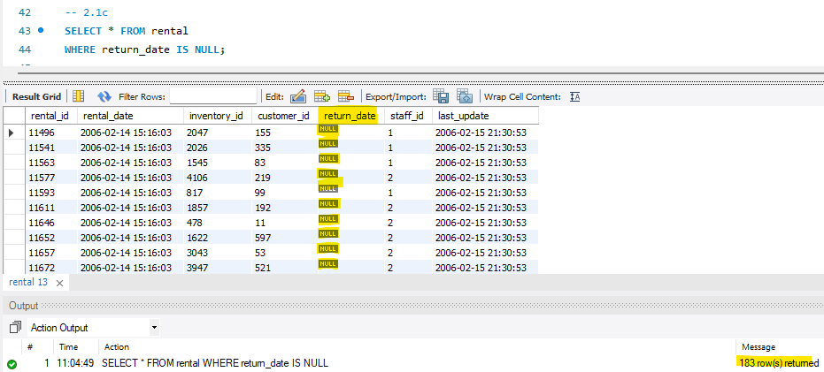

### Exercise 2.2 - Create a Partial Rental Backup

**What This Exercise Was About**

The final part involved creating a backup table named `returned_rental`. The table contained only the rental records that had been
returned. The number of records in the new table was then compared with the count of returned rentals from Exercise 2.1b to verify the
result.

**Screenshot of Output:**

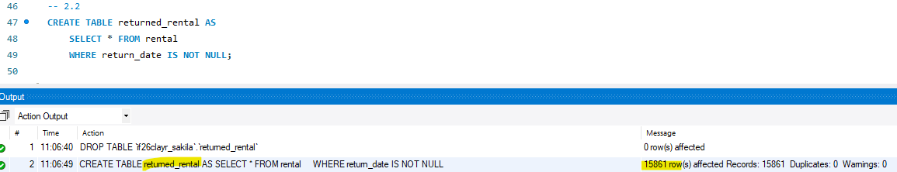

[Back to the top](#table-of-contents)

---

## Exercise 3 - Drop Tables

### What This Exercise Was About

This exercise focused on removing the backup tables created in the previous exercises. The `customer_full_backup` and `returned_rental`
tables were deleted from the database using SQL statements.

After executing the statements, the database schema was refreshed to verify that both backup tables had been removed.

### New Concepts

- Using `DROP TABLE` to remove tables from a database.
- Understanding the difference between deleting records and dropping an entire table.
- Verifying changes to the database schema.

### Learning Outcomes

- Learned how to remove tables that are no longer needed.
- Understood that dropping a table removes both the table structure and its stored data.
- Practiced verifying database changes after executing a statement.

### Exercise 3.1 - Drop the Backup Tables

**What This Exercise Was About**

This part involved dropping the `customer_full_backup` and `returned_rental` tables created in Exercises 1 and 2.

**Screenshot of Output:**

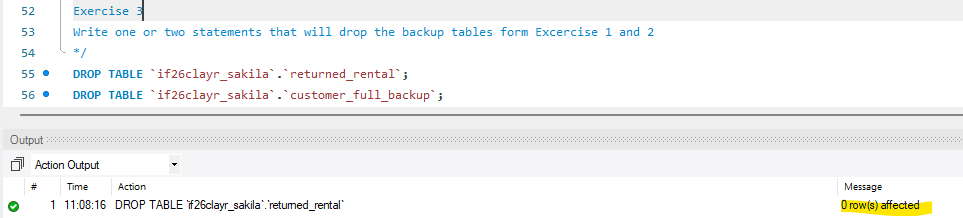

[Back to the top](#table-of-contents)

---

## Exercise 4 - Insert Statement Without a Column List

### What This Exercise Was About

This exercise focused on inserting new records into the Sakila database without explicitly listing the column names in the `INSERT`
statements.

The process involved creating a new city, creating an address associated with that city, and then creating a customer associated with the
new address. The records had to be inserted in the correct order because the tables are connected through foreign key relationships.

The assignment specified the following expected IDs:

- City ID: `601`
- Address ID: `606`
- Customer ID: `600`

### New Concepts

- Using `INSERT INTO` without an explicit column list.
- Using `DEFAULT` for auto-incrementing columns and columns with default values.
- Using `NULL` for columns that allow null values.
- Understanding column order when inserting records without a column list.
- Maintaining relationships between tables through foreign keys.
- Verifying inserted records using `SELECT` statements.

### Learning Outcomes

- Learned how to insert records into existing database tables.
- Understood why values must match the table's column order when no column list is provided.
- Practiced creating related records in the correct order.
- Improved understanding of primary keys, foreign keys, and database relationships.

### Exercise 4.1 - Insert a New City

**What This Exercise Was About**

This part involved inserting a new city into the `city` table using country ID `103`, which represents the United States in the assignment.
The new city was then retrieved with a `SELECT` query to verify that it was created successfully.

The expected city ID was `601`.

**Screenshot of Output:**

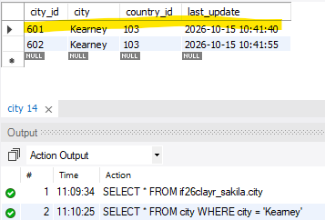

### Exercise 4.2 - Insert a New Address

**What This Exercise Was About**

This part involved inserting a new address into the `address` table using city ID `601`. The address was associated with the city created
in the previous step.

A query filtering by city ID `601` was used to verify that the address had been created successfully.

The expected address ID was `606`.

**Screenshot of Output:**

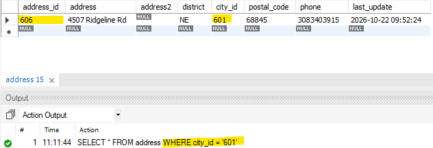

### Exercise 4.3 - Insert a New Customer

**What This Exercise Was About**

This part involved inserting a new customer into the `customer` table using address ID `606` and store ID `1`. The new customer record was
then retrieved by filtering on the address ID to verify that the insertion was successful.

The expected customer ID was `600`.

**Screenshot of Output:**

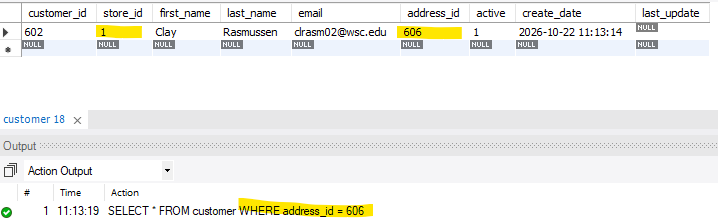

[Back to the top](#table-of-contents)

---

## Exercise 5 - Insert Statement Using a Column List

### What This Exercise Was About

This exercise focused on inserting a second customer using an explicit column list in the `INSERT` statement.

The new customer used the same address ID (`606`) and last name as the customer created in Exercise 4. The assignment required omitting
columns that were auto-incrementing, had default values, or allowed `NULL`.

### New Concepts

- Using `INSERT INTO` with an explicit column list.
- Specifying which columns receive values.
- Allowing auto-incrementing columns to generate their own IDs.
- Omitting nullable and default-valued columns when appropriate.
- Verifying inserted records with `SELECT` queries.

### Learning Outcomes

- Learned how to insert records using an explicit column list.
- Understood how column lists make insert statements more flexible and readable.
- Practiced allowing MySQL to supply auto-generated IDs and default values.
- Learned how to verify the creation of a new customer record.

### Exercise 5.1 - Insert a Second Customer

**What This Exercise Was About**

This part involved inserting another customer using the same address ID and last name as the first customer. An explicit column list was
used, and unnecessary columns were omitted according to the assignment instructions.

The expected customer ID was `601`.

### Exercise 5.2 - Verify the Second Customer

**What This Exercise Was About**

This part involved writing a `SELECT` query that filtered on address ID `606`. The results were used to verify that both customer records
associated with the address existed.

**Screenshot of Output:**

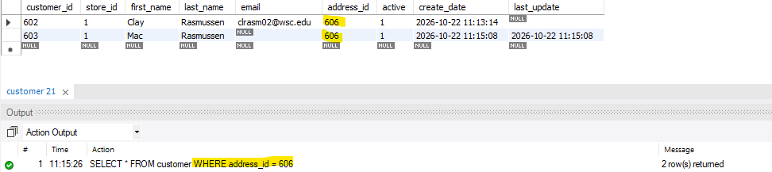

[Back to the top](#table-of-contents)

---

## Exercise 6 - Update Multiple Columns for a Single Record

### What This Exercise Was About

This exercise focused on modifying existing customer records using the `UPDATE` statement.

The first and second customer records were updated individually. For each customer, the store ID was changed to `2`, and the email address
was updated. The customer IDs were used in the `WHERE` clauses to ensure that each statement targeted the intended record.

### New Concepts

- Using `UPDATE` to modify existing records.
- Updating multiple columns in a single statement.
- Using `WHERE` to target a specific record.
- Verifying changes using `SELECT` queries.
- Understanding the importance of filtering update statements correctly.

### Learning Outcomes

- Learned how to update multiple columns in one record.
- Practiced updating individual records using their primary keys.
- Understood how the `WHERE` clause prevents unintended updates to other records.
- Learned how to verify changes after executing an update.

### Exercise 6.1 - Update the First Customer

**What This Exercise Was About**

This part involved updating the first customer, identified by customer ID `600`. The customer's store ID was changed to `2`, and the email
address was updated.

### Exercise 6.2 - Update the Second Customer

**What This Exercise Was About**

This part involved updating the second customer, identified by customer ID `601`. The customer's store ID was changed to `2`, and the email
address was updated.

### Exercise 6.3 - Verify Both Customer Records

**What This Exercise Was About**

This part involved retrieving both customer records by filtering on address ID `606`. The results were used to confirm that the store IDs
and email addresses had been updated correctly.

**Screenshot of Output:**

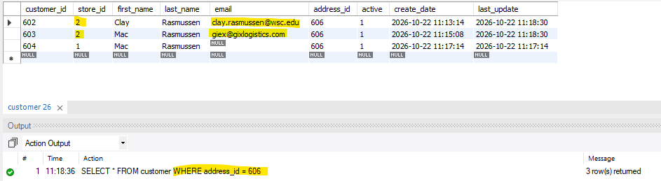

[Back to the top](#table-of-contents)

---

## Exercise 7 - Update Multiple Records (Rows)

### What This Exercise Was About

This exercise focused on updating multiple customer records with a single `UPDATE` statement.

Both customers created earlier were associated with address ID `606`. The goal was to change the address ID for both records to `605` using
a `WHERE` clause that selected records with the original address ID.

A verification query was then used to confirm that both records had been updated.

### New Concepts

- Updating multiple records with one `UPDATE` statement.
- Filtering multiple records using a shared column value.
- Understanding how a single condition can affect more than one row.
- Verifying updates using a `SELECT` query.

### Learning Outcomes

- Learned how to update multiple records with a single SQL statement.
- Understood how the `WHERE` clause determines which rows are modified.
- Practiced verifying multi-row updates.
- Recognized the importance of checking the number of affected rows before relying on an update.

### Exercise 7.1 - Update Both Customer Addresses

**What This Exercise Was About**

This part involved changing the address ID from `606` to `605` for both newly created customer records. The statement filtered on address
ID `606` so that both matching customers would be updated.

### Exercise 7.2 - Verify the Updated Records

**What This Exercise Was About**

This part involved querying the customer table using address ID `605`. The results were used to verify that both customer records had been
updated successfully.

**Screenshot of Output:**

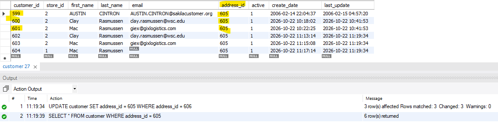

[Back to the top](#table-of-contents)

---

## Exercise 8 - Write Delete Statements

### What This Exercise Was About

This exercise focused on deleting the records created during the earlier exercises. The city, address, and customer records were targeted
using their respective IDs.

The exercise also involved verifying that the records had been deleted and documenting any issues encountered during the process.

Because the tables are related through foreign keys, deletion order and referential integrity are important considerations.

### New Concepts

- Using `DELETE FROM` to remove records.
- Filtering delete statements with `WHERE`.
- Deleting records by their primary keys.
- Understanding foreign key constraints and referential integrity.
- Verifying that records have been deleted.
- Troubleshooting database errors caused by relationships between tables.

### Learning Outcomes

- Learned how to delete specific records from database tables.
- Understood why `WHERE` clauses are important when deleting data.
- Practiced verifying deletions with `SELECT` queries.
- Improved understanding of foreign key constraints and the dependencies between related tables.
- Learned to investigate and resolve errors that can occur when deleting related records.

### Exercise 8.1a - Delete the New City

**What This Exercise Was About**

This part involved writing a `DELETE` statement to remove the city record identified by city ID `601`.

### Exercise 8.1b - Delete the New Address

**What This Exercise Was About**

This part involved writing a `DELETE` statement to remove the address record identified by address ID `606`.

### Exercise 8.1c - Delete the New Customers

**What This Exercise Was About**

This part involved deleting the two customer records created earlier, identified by customer IDs `600` and `601`.

### Exercise 8.2 - Verify Deleted Records

**What This Exercise Was About**

This part involved writing queries to verify that the specified city, address, and customer records had been deleted. The results were used
to confirm whether the records still existed in their respective tables.

### Exercise 8.3 - Document Results and Resolve Issues

**What This Exercise Was About**

The final part involved documenting the results of the deletion statements and describing any issues encountered.

One possible issue is a foreign key constraint preventing a record from being deleted while another record still references it. If an error
occurs, the related records and their dependencies must be examined to determine the appropriate deletion order.

The actual error encountered and the solution used should be documented based on the results of the SQL statements.

**Results and Resolution:**

Document the error encountered, the reason for the error, the steps taken to resolve it, and the final verification results here.

[Back to the top](#table-of-contents)

## Help
___
If you encounter issues while completing the exercises, try the following troubleshooting steps:

- Make sure the MySQL server is running correctly.
- Confirm that the Sakila database is selected before executing queries.
- Verify that each SQL statement is written correctly and follows the required column order.
- Execute statements individually to identify where an error occurs.
- Check that records referenced by foreign keys exist before inserting related records.
- Review foreign key constraints if a deletion fails.
- Verify that the correct IDs are being used in `UPDATE` and `DELETE` statements.
- Refresh the schema window after creating or dropping tables.
- Restart your SQL editor if it stops responding.
- If necessary, re-clone the repository and confirm that all required files are present.

[Back to the top](#table-of-contents)

## Author
___

**Clay Rasmussen**
* **Clay's GitHub Profile**: [Clay-Rasmussen](https://github.com/Clay-Rasmussen)
* **Clay's Email**: [clrasm02@wsc.edu](mailto:clrasm02@wsc.edu)

[Back to the top](#table-of-contents)
